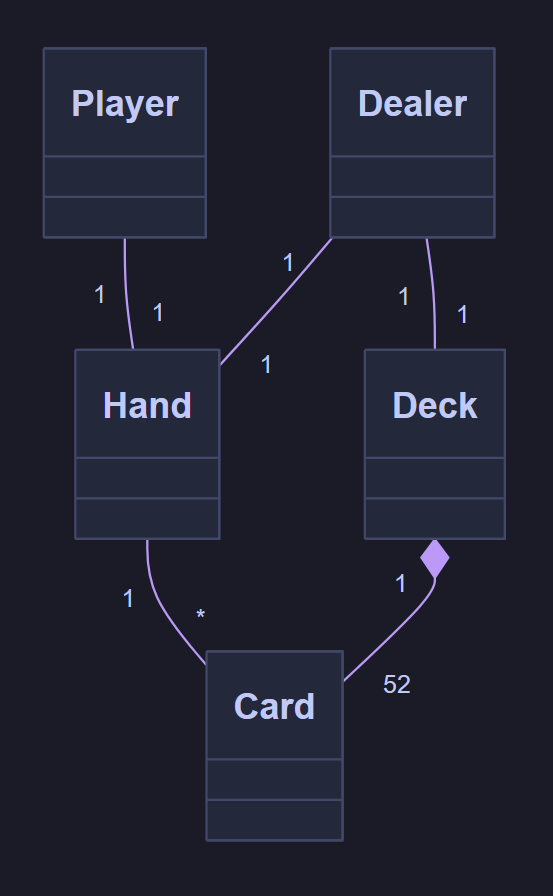
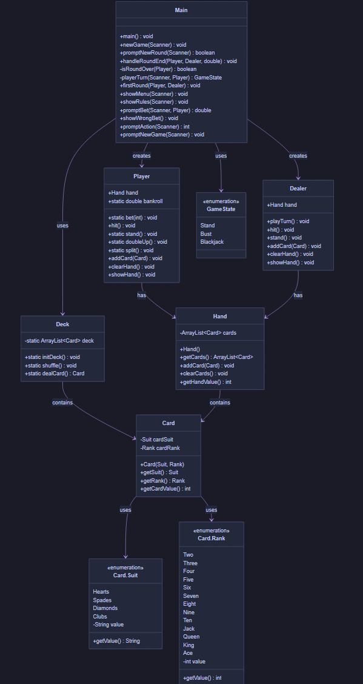

# Blackjack - Efterårsopgave 2026
10. Oktober - Virker, men trænger til refactoring og finpudsning.

## Domænemodel
Simpel domænemodel med de 5 grundlæggende domæner valgt til dette spil.
(Bruger kun navneord, så ting som sats, resultat og lignende er ikke inkluderet her.)


## Class Diagram
Grundlæggende class diagram inden udviklingen rent faktisk er begyndt.


```
classDiagram
    class Card {
        -Suit cardSuit
        -Rank cardRank
        +Card(Suit, Rank)
        +getSuit() Suit
        +getRank() Rank
        +getCardValue() int
    }

    class Card.Suit {
        <<enumeration>>
        Hearts
        Spades
        Diamonds
        Clubs
        -String value
        +getValue() String
    }

    class Card.Rank {
        <<enumeration>>
        Two
        Three
        Four
        Five
        Six
        Seven
        Eight
        Nine
        Ten
        Jack
        Queen
        King
        Ace
        -int value
        +getValue() int
    }

    class Deck {
        -static ArrayList~Card~ deck
        +static initDeck() void
        +static shuffle() void
        +static dealCard() Card
    }

    class Hand {
        -ArrayList~Card~ cards
        +Hand()
        +getCards() ArrayList~Card~
        +addCard(Card) void
        +clearCards() void
        +getHandValue() int
    }

    class Player {
        +Hand hand
        +static double bankroll
        +static bet(int) void
        +hit() void
        +static stand() void
        +static doubleUp() void
        +static split() void
        +addCard(Card) void
        +clearHand() void
        +showHand() void
    }

    class Dealer {
        +Hand hand
        +playTurn() void
        +hit() void
        +stand() void
        +addCard(Card) void
        +clearHand() void
        +showHand() void
    }

    class Main {
        +main() void
        +newGame(Scanner) void
        +promptNewRound(Scanner) boolean
        +handleRoundEnd(Player, Dealer, double) void
        -isRoundOver(Player) boolean
        -playerTurn(Scanner, Player) GameState
        +firstRound(Player, Dealer) void
        +showMenu(Scanner) void
        +showRules(Scanner) void
        +promptBet(Scanner, Player) double
        +showWrongBet() void
        +promptAction(Scanner) int
        +promptNewGame(Scanner) void
    }

    class GameState {
        <<enumeration>>
        Stand
        Bust
        Blackjack
    }

    Card --> Card.Suit : uses
    Card --> Card.Rank : uses
    Deck --> Card : contains
    Hand --> Card : contains
    Player --> Hand : has
    Dealer --> Hand : has
    Main --> Player : creates
    Main --> Dealer : creates
    Main --> Deck : uses
    Main --> GameState : uses
```